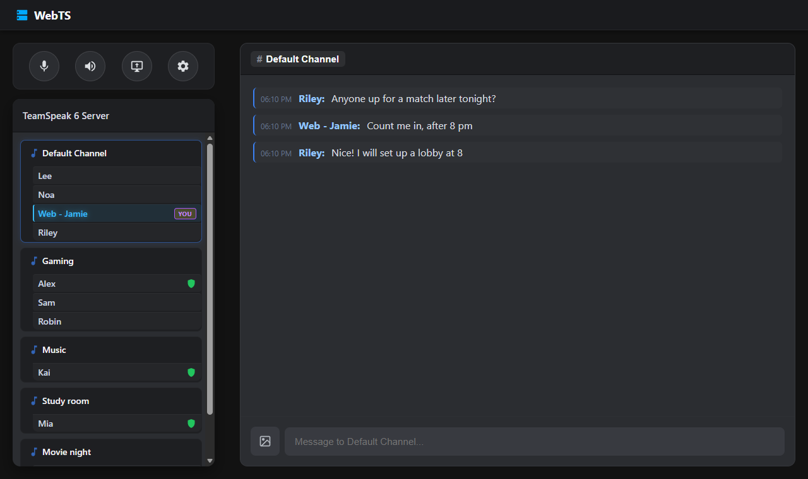
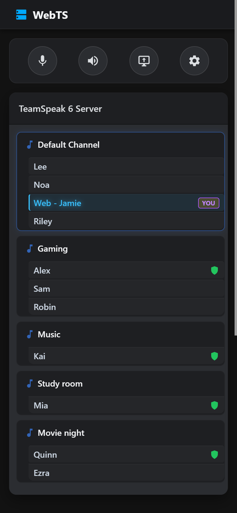

# WebTS

**A self-hosted web client for TeamSpeak servers.** Your friends open a web page and they're on your TeamSpeak
server: voice, chat, pictures and streams, on a PC or a phone, with nothing to install.

> WebTS is an independent fan project. It is not affiliated with, endorsed by or supported by TeamSpeak Systems GmbH.
> "TeamSpeak" is their trademark. Use it on servers you run or are allowed to connect to.

<p>
  
  
</p>

## What it does

- **Voice:** push-to-talk or voice activation, per-person volume, mute and sound mute in sync with the server, talk
  power respected. Works in Chrome, Edge, Safari and Firefox (also Firefox on Android, through Opus in WebAssembly).
- **The channel tree** as the TeamSpeak app shows it: the server's own icons, group badges, avatars, spacers and
  channel banners, in the server's order. Move between channels with a click.
- **Chat:** channel and private chat, pokes, link previews, and optionally a chat history across days, locked on
  disk (like the TeamSpeak app keeps it).
- **Pictures:** send a photo (camera or gallery on a phone, paste or drop on a PC). It goes into the channel's file
  browser and shows in the TeamSpeak app too. Hidden photo details such as GPS location are removed first.
- **Streams:** watch screen shares and cameras from the TeamSpeak 6 app, share your own screen (Chromium-based
  browsers and Firefox on a computer, up to 4K) or your camera (also on phones). An optional TURN relay helps people
  behind strict networks.
- **Installable** as an app on phones.

Every browser gets its own TeamSpeak connection and identity, so people show up on the server as themselves
(`Web - Alex`), keep their server groups between visits, and the server's permissions apply to them.

## How it works

```
browser ──https/WebSocket──▶ WebTS (Node, this repository) ──TeamSpeak protocol (UDP 9987, TCP 30033)──▶ your TeamSpeak server
        ◀──── streams go straight between the browser and the TeamSpeak app (WebRTC), or through your TURN relay ────▶
```

WebTS runs next to your TeamSpeak server, as one Docker container. It serves the web page and turns each browser
connection into a TeamSpeak client.

## Quick start (Docker)

1. You need a TeamSpeak server (3 or 6; streams need 6) and Docker.
2. Make a folder with the two files WebTS needs, and your settings:
   ```bash
   mkdir webts && cd webts
   curl -fLO https://raw.githubusercontent.com/KorppuJauho/webts/main/docker-compose.yml
   curl -fL -o .env https://raw.githubusercontent.com/KorppuJauho/webts/main/.env.example
   ```
   In `.env`, set at least `TS_HOST`, `PUBLIC_URL` and the access settings (next section).
3. Start it (Docker downloads the published image, `ghcr.io/korppujauho/webts`, for x86 and ARM):
   ```bash
   mkdir -p data sounds && sudo chown 1000:1000 data
   docker compose up -d
   ```
   WebTS listens on `127.0.0.1:3002`. Put your sign-in in front of it (next section) and open `PUBLIC_URL`.

The `data/` folder holds everyone's TeamSpeak identity (with its private key) and saved settings. Back it up: if
it's lost, everyone gets a new identity and loses the server groups tied to the old one.

Rather build it yourself? Clone this repository and use the `build` lines in `docker-compose.yml` instead of the image.

### Updating

```bash
docker compose pull
docker compose up -d
```

The `data/` folder keeps everyone's identity, settings and chat history across updates. What each release changes is
in [CHANGELOG.md](CHANGELOG.md).

### Versions

- **1.0.x** fixes bugs, **1.x.0** adds features. Neither breaks your setup: settings keep their names (a renamed one
  keeps accepting its old name) and the `data/` folder keeps working.
- A **2.0.0** would be the first release that needs changes on your side, and its notes would say exactly which.
- Image tags: `1` follows every 1.x release (what `docker-compose.yml` uses), `1.0` only fixes to 1.0, `1.0.0` that
  exact release, and `latest` the newest release.
- Each image is built by this repository's GitHub workflow, with a signed record of how. To check one:
  `gh attestation verify oci://ghcr.io/korppujauho/webts:1.0.0 --repo KorppuJauho/webts`

## Access: who gets in

WebTS has no login of its own. Pick one of these with `ACCESS_MODE`:

| Mode | For | How it works |
| --- | --- | --- |
| `cloudflare-access` (recommended) | Cloudflare Tunnel + Cloudflare Access (free for small teams) | Access signs in your friends (email code, Google, GitHub...). WebTS checks Access's signed token on every request, so nothing gets in around Access. |
| `header` | Another login proxy: Authelia, Authentik, oauth2-proxy... | The proxy puts the user name in a header (`ACCESS_HEADER`, default `Remote-User`). **WebTS must only be reachable through the proxy**, or anyone could send that header. |
| `public` | A server that's open to everyone anyway | Anyone with the address gets in; each browser gets its own identity. Needs `I_UNDERSTAND_THIS_IS_PUBLIC=true`. |
| `signed-note` | Your own gateway | Your gateway signs `{ id, name, exp }` with a shared secret and passes it in a header (see `src/access.ts`). |

### Cloudflare Tunnel + Access, step by step

1. In Cloudflare Zero Trust, create a **tunnel** and a public hostname (e.g. `webts.example.com`) pointing to
   `http://webts:3002` (or `http://localhost:3002`).
2. Create an **Access application** (self-hosted) for that hostname, with a policy listing who may sign in.
3. Copy its **Application Audience (AUD) tag** to `CF_ACCESS_AUD`, and your team domain
   (`<team>.cloudflareaccess.com`) to `CF_ACCESS_TEAM_DOMAIN`. Set `PUBLIC_URL=https://webts.example.com`.

The menu's "Sign out" then signs out of Access.

## TeamSpeak permissions

WebTS users are ordinary TeamSpeak clients and get the server's normal permissions. For pictures, they need
permission to upload files (and to create the picture folder) in channels; viewers need permission to download
files. If uploads are refused, WebTS says so in the chat.

The TeamSpeak apps fetch pictures from the server's file transfer port, which the server tells them is 30033 (its
own port). If you publish the server's port 30033 under another number (e.g. Docker `30035:30033`), the apps get no
answer and show pictures as empty boxes, while WebTS still shows them. Publish it as the same number.

WebTS itself follows the same port, unless it is told otherwise: if it reaches the server from outside the server's
Docker network and the file port is published under another number, set `TS_FILE_PORT` to that number (e.g. `30035`).
That fixes WebTS only; the TeamSpeak apps still need the same number.

## Sounds

TeamSpeak's own UI sounds are copyrighted and not included. To have them, copy the `.wav` files from your own
TeamSpeak 3 client's `sound/default` folder into `sounds/` (mounted read-only into the container). Without them
WebTS is simply quiet.

## Relay (optional)

Streams go straight between the browser and the TeamSpeak app. Some networks (CG-NAT, strict firewalls) block that;
a TURN relay carries the video instead. Either your own **coturn** (`TURN_URLS` + `TURN_SECRET`, coturn's
`static-auth-secret`) or **Cloudflare Realtime TURN** (`CF_TURN_KEY_ID` + `CF_TURN_KEY_TOKEN`, optionally a monthly
cap with `CF_ACCOUNT_ID` + `CF_ANALYTICS_TOKEN`). Browsers use the relay only when a direct connection fails.

## Chat history (optional)

With `CHAT_HISTORY=on`, WebTS keeps each person's channel chats, private chats and join/leave lines for
`CHAT_HISTORY_DAYS` (30) days, at most `CHAT_HISTORY_LINES` (300) lines per conversation, and shows them again the
next time they open WebTS, with the day ("21:36 - Mon") like the TeamSpeak app.

- **Only what they were there for:** TeamSpeak sends chat only to people who are connected, and channel chat only
  to those in the channel. So a person's history holds what their own WebTS connection saw while it was open, from
  the channels they were in, just as the TeamSpeak app only shows what it was connected for. To catch everything,
  leave WebTS open.
- **Stored on your server:** one file per person in `DATA_DIR/chat/`, locked with `CHAT_HISTORY_KEY`
  (AES-256-GCM). Keep the key out of your backups of the data folder, and those copies can't be read; but while
  WebTS runs it has the key, so whoever runs the server can read the chat. Tell your users.
- Pictures stay in the channel's file browser; the history holds only the line that shows them.
- Lines past their days go automatically; the file of someone who hasn't been back for that long is removed.
- A file that doesn't open (another key, damaged) is left as it is and that person gets no history.
  Lost the key? Set a new one: the history starts over, and the old files are removed after `CHAT_HISTORY_DAYS`.

## Several servers (optional)

WebTS can offer several TeamSpeak servers: people pick one from a list when they open it, and switch with "Change
server" in the menu. List them in `servers.json` (copy `servers.example.json`; with Docker, uncomment its line in
`docker-compose.yml`). When the file is there, the `TS_*` settings aren't used.

- Each server: `id` (letters, digits, `-`, `_`), `name` (what the list shows), `host`, and optionally `port` (9987),
  `filePort` (like `TS_FILE_PORT`), `password` and `defaultChannel`.
- Only the servers you list: nobody can make WebTS connect anywhere else, so it can't be used to reach or flood other
  people's servers from your address. The page only ever learns their ids and names.
- One server at a time per person (switching reconnects). Everyone let in may use every server on the list.
- Each person keeps one TeamSpeak identity for all of them, like the TeamSpeak app. Their chat history is kept per
  server; give the server you started with the id `main` to keep its history from before.
- `servers.json` can hold server passwords: keep it out of git and readable only by you.

## Connect anywhere (optional)

With `ALLOW_ANY_SERVER=on`, people can type any TeamSpeak server's address: `ts.example.com`, `203.0.113.7:9987`
or `[2001:db8::1]:9987`. A name without a port is looked up like the TeamSpeak app does (its `_ts3._udp` record
first). They can save servers as favourites (kept by WebTS, so they follow them to their other devices) and mark one
with ★ to connect to it when WebTS opens; the menu lists the favourites and "Connect to...". Right-click a favourite
(or its ✎) to edit its name, address, the nickname used on that server, its password and auto-connect. Servers you list
(`servers.json`, or `TS_HOST` when set) are shown as suggestions.

**Think before switching it on.** Every connection comes from your machine's address: whatever people do on other
servers, those servers see you.
- **Private and reserved addresses are refused** (this machine, your home network, carrier NAT, link-local,
  multicast...), checked after the name is looked up, so a name can't lead there. Allow your own LAN server on purpose
  with `ALLOW_SERVERS` (addresses, ranges like `10.0.0.0/8`, or names).
- **At most `ANY_SERVER_TRIES` (10) different servers per person per hour**, and one connection per person as always.
- **With `ACCESS_MODE=public` anyone on the internet can use it** to connect anywhere from your address. WebTS
  allows it and says so in its log; a sign-in in front (README: "Access") is much safer.
- **Server passwords are never kept by WebTS:** they're sent when connecting, and the page keeps one only in that
  browser, and only when "Remember the password" is ticked. Favourites hold addresses and names only.
- WebTS's log notes who connects to which address (`[Servers]` lines).
- Some servers require a stronger identity ("security level") than WebTS's; those refuse the connection.

## Known limitations

- Sharing a screen needs a browser on a computer (on a phone you share the camera). Firefox shares the
  picture only, without sound; Chromium-based browsers (Chrome, Edge, Brave, Opera...) share sound from a tab or the
  entire screen.
- Pictures pasted in the TeamSpeak 6 app (its paperclip button) are stored in TeamSpeak's own cloud and can't be
  shown in WebTS; WebTS shows a short note instead. Pictures sent from WebTS work everywhere.

## All settings

See [`.env.example`](.env.example): every setting with a short explanation.

## Development

```bash
npm ci
npm test          # offline tests: protocol encryption, file transfer, access modes, pictures, chat history
npm run typecheck
npm start         # needs the settings as environment variables (or a .env loaded by your shell)
```

## Licence

WebTS is licensed under the [Open Software License 3.0](LICENSE): you may use, change and share it; if you run a
changed version for other people, you must make your changed source available to them. It contains code from other
projects, credited in [THIRD_PARTY_NOTICES.md](THIRD_PARTY_NOTICES.md).
